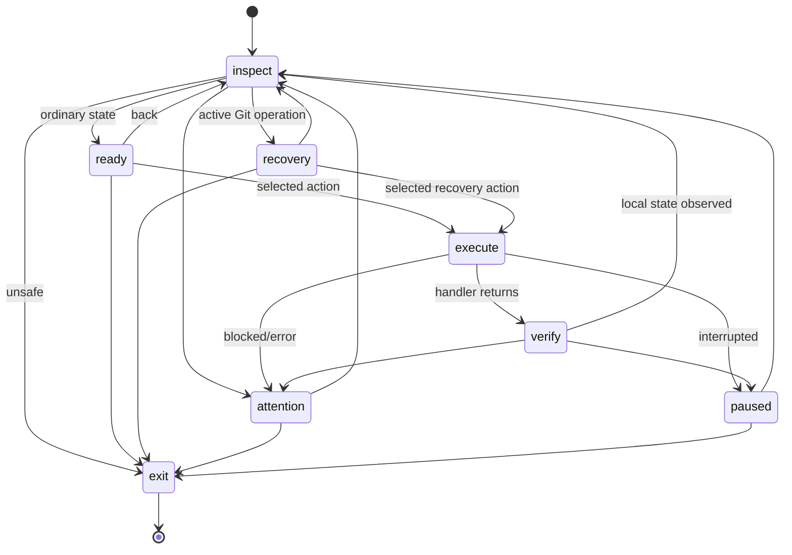

# GitAppho v7 — graph-first architecture

This is an incremental implementation over the existing v6 engine, not a rewrite or a formal proof of safety. The old Git handlers and their safety checks remain. A session graph is now executable; its edges are checked at each state transition. The feature registry is separate from the terminal renderer.

## Three different graphs

1. Git commit DAG: commits and parent edges. Git is the authoritative store; use existing ancestry/reachability commands rather than reconstructing the entire graph in Python. Merge creates another edge; rebase creates new commits.
2. Application session graph: directed cyclic graph with error, pause and recovery paths. The implemented graph below has 8 nodes. No automatic retry of a mutation.
3. Workflow-level dependency graph: the next refinement. Each operation should become a typed plan with prerequisites, approved snapshot, mutation, reconciliation and recovery steps. Existing v6 handlers still contain internal procedural steps; the registry does not turn those into a fully validated DAG yet.

The graph includes cycles on purpose. BFS verifies structural reachability from inspection and a route to exit from every vertex. Strongly connected components expose the retry/recovery cluster. These checks do not prove the guards are satisfiable, a user will exit, or Git cannot fail. No artificial transitions are added to bypass safety policy.

## State vector and constraints

Represent repository kind, branch/HEAD state, staged/unstaged/untracked/conflicted flags, in-progress Git operation, account and remote identity, freshness, plus session state separately. Working tree flags may coexist; do not treat them as mutually exclusive. Remote status stays unknown until an authenticated check. In this version, guards and observations are implemented in the registry and v6 functions, not a single exhaustive Cartesian-product state enumerator.

## Data structures

| Structure | Implemented use / future use |
|---|---|
| Adjacency map (dict of sets) | Executable session graph and edge validation |
| Hash map | Action registry: id, group, display text, aliases, guard flags, handler |
| Inverted index (token -> set of actions) | Prefix/token lookup, fuzzy suggestions never auto-executed |
| Deque | BFS frontier and bounded recent event journal |
| Set | Visited vertices, search intersections, safety guards |
| Immutable dataclass | Action metadata |
| JSON journal, atomic replace | Last observed application state and recent events, outside the repository |
| POSIX advisory lock | Prevent two v7 interactive sessions of the same repository; does not lock external Git or legacy direct flags |
| Stack | Planned submenu navigation; current legacy submenus unwind to home on recoverable errors |
| DAG / topological order | Planned per-operation precondition and verification pipeline |
| Priority queue | Planned ranking of safe applicable actions by cost, impact, and user preferences |
| Markov transition model | Planned opt-in aggregate telemetry; no invented transition probabilities |
| Binary search | Existing Git bisect workflow for locating regressions |

## Action lifecycle and failure rules

- Mistyped confirmation: reprompt at the same step. The command verb is case-insensitive; exact case is still required for operands like branch names. Cancel is explicit. No mutation is authorised by a mistype.
- Recoverable failure: stop the current workflow, retain the session, inspect actual local Git state, allow a new choice. Do not repeat an operation automatically. The journal does not store command arguments, repository contents, credentials or messages.
- Handler returned: inspect actual local state. Return is not proof of success (legacy handlers may return after cancellation or failed commands). For uncertain network outcomes, verify the exact remote state before retrying. The journal is advisory, not a distributed transaction or remote confirmation.
- EOF closes the terminal; next launch inspects the real state. A journal left in execute/verify/attention/paused warns the user and suppresses a direct requested action on resume. Abrupt termination between Git writes and journal updates can leave ambiguity. No arbitrary workflow resumption or automatic rollback.
- No automatic conflict-side selection. Resolve contents in an editor and use existing guided continue/abort paths. No universal automatic stash-conflict rollback.
- Journal stores recent transitions for the current session, not permanent analytics or snapshots of uncommitted files. Checkpoints preserve committed trees; stash backups preserve the selected saved work.
- Existing safeguards remain: exact dedicated project root, no home/inherited repo writes, no force push, no hard reset, no automatic rewrite of protected or verified remote-reachable commits, Gitleaks scan before pushes. A trusted repo and trusted Git executables are still prerequisites. Other Git processes may change state concurrently; v6 rechecks remain relevant.

## Concurrency roadmap

Use an event queue for cancellable read-only tasks (fetching metadata, status, scan progress), with generation numbers tied to repo/account/branch/HEAD snapshots. Serialize all mutating operations; invalidate stale approvals. Distinguish timeout from confirmed failure. Never parallelise competing writes to index or refs. Current implementation is synchronous with a session lock, not an asynchronous engine.

## Probability roadmap

Only after consented and aggregated measured outcomes exist, estimate `P(next state | state, action)` using counts; for k outcomes, a smoothed estimate is `(count+alpha)/(total+k*alpha)`. Do not confuse frequency with safety. Estimate completion time, failed attempts, abandonment and recovery rates; rank only actions that pass deterministic safety guards. No telemetry is sent by this build. For stronger verification use generated state sequences and model-based/property tests, then consider a formal specification of high-risk transitions.

## Feature coverage

42 action routes (some open existing multi-action submenus). This is a discoverability count, not 42 unique Git primitives or a complete Git implementation. All five primary intentions remain. Local initialization is new; branch deletion, push-existing-commits and selected-remote merge are explicitly reachable again. Existing advanced tools remain accessible. Use `gitappho find` to browse, `gitappho find stash pop` to search, and `gitappho --graph-check` to validate structure.

Still not implemented: linked worktrees, arbitrary interactive rebase, remote branch deletion, tag creation/publication workflow, issue creation, PR review/fork workflows, LFS management, arbitrary Git command passthrough, automatic secret incident cleanup, automatic conflict resolution, and fully asynchronous job execution. Do not claim full Git feature parity. The previous design's larger conceptual graph is a future specification, distinct from this executable 8-state session graph.
